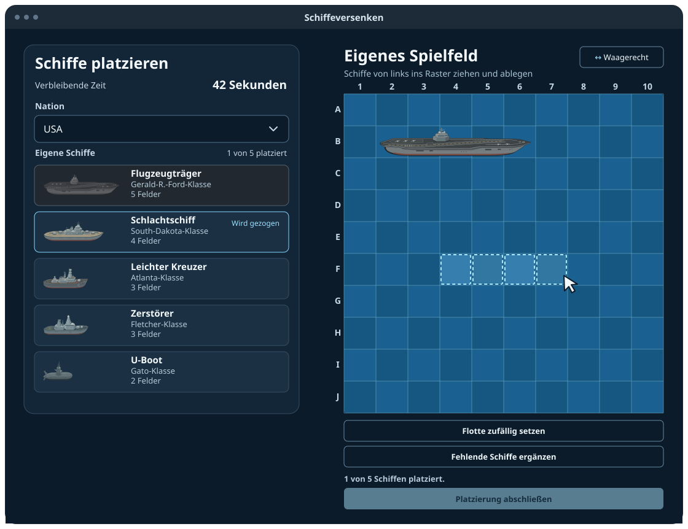

# Schiffeversenken – Anzeige im Browser

## Modus und Countdown

Der Browsertitel lautet **„Schiffeversenken“**.

Der Countdown steht bei der Platzierung links in der Flottenauswahl unter **„Schiffe platzieren“** und beginnt bei **01:00**. Während der Partie steht der Zugstatus im eigenen Rahmen über der Protokolltafel. Dort steht **„Sie sind dran“**, **„Der Computer ist dran“** oder bei einer Partie gegen einen Menschen dessen Spielername mit **„ist dran“**. Im eigenen Zug zeigt der Rahmen den Schuss-Countdown ab 12 Sekunden unter **„Verbleibende Zeit“** an. Schussergebnisse werden direkt auf den Rastern markiert. Der Computer wartet ab Zugbeginn oder nach seinem Treffer anderthalb Sekunden bis zum nächsten Schuss.

## Layout vor der Partie

### Startfenster

- **Links · Neue Partie** – Der Spieler trägt seinen Namen ein und wählt **Leicht**, **Mittel** oder **Schwer**. **Mittel** ist vorausgewählt. Die gewählte Stufe bestimmt die Anzeige der Wasserschüsse und die [Zielwahl des Computers](Spielverlauf.md#schwierigkeitsstufen). Darunter stehen die Schaltflächen **„Gegen Computer spielen“** und **„Spielanfrage erstellen“**.
- **Rechts · Offene Spielanfragen** – Jede Zeile zeigt den Namen des wartenden Spielers, die gewählte Schwierigkeitsstufe, die Spalte **„Wartet seit“** und **„Beitreten“**. Die Wartezeit wird seit dem Erstellen der Anfrage im Format **MM:SS** hochgezählt. Beim Beitritt gilt die Stufe der Anfrage. Nach dem Erstellen einer eigenen Anfrage zeigt die Startseite **„Warten auf einen Gegner“**. Ist die Liste leer, erscheint **„Keine offenen Spielanfragen“**.

- **Unten · Bestenliste** – Platz 1 ist auf der Startseite immer mit Spielernamen, gespielter Nation, Punktzahl und dem Datum des Rekords sichtbar. Über **„Top 30 anzeigen“** lässt sich die Rangliste mit bis zu 30 Einträgen aufklappen. Jeder Eintrag zeigt Platz, Spielername, die für diese Partie gewählte Nation, Punktzahl und Datum. Platz 1 bleibt auch beim Zuklappen sichtbar.

Die Punkteberechnung ist noch offen. Der Ablauf der Spielanfragen steht im [Spielverlauf](Spielverlauf.md#partie-starten).

### Schiffe platzieren

- **Links · Flottenauswahl** – Der Spieler wählt die Nation und sieht die dazugehörigen [Schiffe](Schiffstypen.md) mit Typ, Länge und passender SVG-Vorschau. Darüber läuft der **60-Sekunden-Countdown**. Die Liste zeigt, welche Schiffe bereits platziert sind.
- **Rechts · Eigenes Spielfeld** – Das eigene **10 × 10-Raster** ist während der Platzierung genauso groß wie das gegnerische Zielraster in der späteren Partie.
- **Drag-and-drop** – Der Spieler zieht ein Schiff aus der Liste in das Raster. Beim Ziehen hebt die Vorschau die Felder hervor, die das Schiff belegen würde. Eine gültige Platzierung übernimmt das Schiff beim Ablegen. Im ersten Entwurf erscheinen belegte Felder auf dem Raster schwarz, während die Schiffsliste bereits die SVG-Vorschauen zeigt.
- **Zufällige Platzierung** – „Flotte zufällig setzen“ erzeugt eine neue Aufstellung für alle Schiffe. „fehlende Schiffe ergänzen“ erscheint bei einer teilweise gesetzten Flotte. „Platzierung abschließen“ wird verfügbar, sobald alle Schiffe gesetzt sind.

Nach Ablauf des Countdowns wechselt die Ansicht gemäß [Spielverlauf](Spielverlauf.md#flotte-und-platzierung) zur Partie oder zum Ergebnis.

## Layout während der Partie

Die Spielansicht besteht aus drei Elementen.

- **Links · Spielfelder** – Das Zielraster „Gegnerische Flotte“ liegt über dem gleich großen eigenen Raster „eigene Flotte“. Der Spieler schießt durch Klick auf ein Feld im oberen Raster.
- **Rechts oben · Titel und Zugstatus** – Der Spieltitel und „Neu spielen“ stehen neben den Rastern. Der Rahmen darunter zeigt, wer am Zug ist. Auf schmalen Bildschirmen stehen Titel und Zugstatus über den Rastern.
- **Darunter · Protokolltafel** – Über den beiden Flottenübersichten stehen die Schusszähler. Die Flottenübersichten stehen nebeneinander und auf sehr schmalen Bildschirmen untereinander. Die Legende für Treffer und Wasser steht unter der Protokolltafel.

## Spielfelder

Beide Spielfelder sehen aus wie Ausschnitte einer Seekarte und bestehen aus **10 × 10 gleich großen quadratischen Feldern**. Helle Gitterlinien unterteilen die blaue Wasserfläche. Die Zeilen A bis J stehen links, die Spalten 1 bis 10 oben.

## Schiffe

Während der Platzierung ist **jedes belegte Schiffsfeld schwarz**. Ein Schiff bildet eine zusammenhängende Reihe schwarzer Felder, waagerecht oder senkrecht.

Während der Partie zeigt das eigene Raster alle eigenen [Schiffsbilder im SVG-Format](Schiffsbilder/Vektoren/). Im Zielraster erscheint eine Schiffsgrafik, sobald das Schiff versenkt ist. Nach einer Niederlage erscheinen dort zusätzlich die übrigen gegnerischen Schiffe. Beide Raster zeigen die Grafiken entsprechend ihrer Position und Ausrichtung. Die Schussmarkierungen erscheinen darüber.

## Ergebnisansicht

Nach Spielende steht „Gewonnen“, „Verloren“ oder „Unentschieden“ in großer Schrift in der Fenstermitte. Bei einer Niederlage fahren die SVG-Grafiken der verbliebenen gegnerischen Schiffe von links unter den Schriftzug. Flammen zeigen die bereits getroffenen Schiffsabschnitte. Jedes Schiff zieht einen Ballon mit dem Länderkennzeichen hinter sich her. Bei reduzierter Bewegung erscheinen die Schiffe sofort. „Spielfeld ansehen“ schließt die Ergebnisansicht.

## Darstellung auf dem Spielfeld

- **Schiffstreffer** – Eine orange-gelbe Flamme mittig auf dem getroffenen Feld. Mehrere getroffene Felder desselben Schiffs erhalten je eine eigene Flamme. Bei einem erneuten Treffer auf dieselbe Koordinate bleibt es bei einer Flamme auf dem Feld.
- **Wasserschuss** – Ein einzelner runder, hellblauer Punkt mittig auf dem beschossenen Wasserfeld.

Im Zielraster bleiben Schiffstreffer sichtbar. Auf „Leicht“ bleiben mindestens 25 Wasserfelder markiert, sobald so viele getroffen wurden. Auf „Mittel“ sind es 21 und auf „Schwer“ 17. Bei jedem neu hinzukommenden Wasserfeld kann danach jeweils eine ältere Markierung verschwinden. Die Wahrscheinlichkeit beträgt auf „Leicht“ 70 %, auf „Mittel“ 65 % und auf „Schwer“ 60 %. Ein erneuter Schuss auf ein bereits markiertes Wasserfeld lässt die Markierungen unverändert.

Bei Wasser ertönt ein Platscher von 1,75 Sekunden. Bei Schiffstreffern ertönt ein dumpfes Klirren von 1,44 Sekunden. Beide Töne setzen mit dem Schussergebnis ein. Die Wasseraufnahme wurde gekürzt und in der Lautstärke angepasst. Die Metallaufnahme wurde gekürzt, tiefer abgespielt und in den Höhen gedämpft. [„water splash.wav“ von VacekH (CC0)](https://freesound.org/people/VacekH/sounds/189504/), [„Metallic clang“ von tomwilkinson (CC0)](https://freesound.org/people/tomwilkinson/sounds/568786/)

## Protokolltafel

Die Protokolltafel wirkt wie ein Tabletbildschirm mit einem schmalen Rahmen und einer klar gegliederten digitalen Anzeige. „Protokolltafel“ ist der interne Name. Sichtbare Überschriften sind **„Gegnerische Flotte“** und **„Eigene Flotte“**. Beide Bereiche haben innerhalb des Tablets jeweils einen eigenen Rahmen.

- **Eigene Schussergebnisse** – Zähler für abgegebene Schüsse, neue Treffer und redundante Treffer. Sobald ein gegnerisches Schiff versenkt ist, erhält es wie ein eigenes Schiff eine Zeile mit seiner SVG-Grafik und roten Treffermarkierungen. Die Zeile nennt außerdem Typ, Länge und den Status „Versenkt“. Von den verbleibenden unbekannten gegnerischen Schiffen erscheint nur die Anzahl.
- **Zustand der eigenen Flotte** – Jedes eigene Schiff erhält eine Zeile mit seinem Typ, seiner Länge, seinem Zustand und der passenden SVG-Grafik. Die Zeilen haben eine feste Reihenfolge, und alle Grafiken sind gleich ausgerichtet, unabhängig von der Position und Ausrichtung der Schiffe auf dem Spielfeld. Eine rote Markierung zeigt jeden sichtbaren Treffer direkt auf dem betroffenen Schiffsabschnitt. Versenkte eigene Schiffe erhalten den Status „Versenkt“.

Die Flottenübersicht zeigt Treffer an eigenen Schiffen in allen [Schwierigkeitsstufen](Spielverlauf.md#schwierigkeitsstufen) ab dem ersten Treffer.

## Eigenes Raster

Das eigene 10 × 10-Raster unter dem Zielraster zeigt die tatsächlichen Schiffspositionen und -ausrichtungen. Gegnerische Schiffstreffer erscheinen sofort als Flammen. Auf allen Stufen erscheinen Wasserschüsse als hellblaue Punkte, wenn ihr Feld höchstens zwei Schritte von einem eigenen Schiffsfeld entfernt liegt. Jeder Schritt kann waagerecht, senkrecht oder diagonal verlaufen.

Bei einem sichtbaren Computerschuss pulsiert zusätzlich der Rahmen des beschossenen Feldes rund drei Sekunden lang. Bleibt ein Wasserschuss verborgen, pulsiert der Außenrahmen des eigenen Rasters. Bei Wasser wechselt die Farbe zwischen Hell- und Dunkelblau, bei einem Schiffstreffer zwischen Hellgelb und Dunkelorange. Währenddessen läuft die Partie normal weiter.
