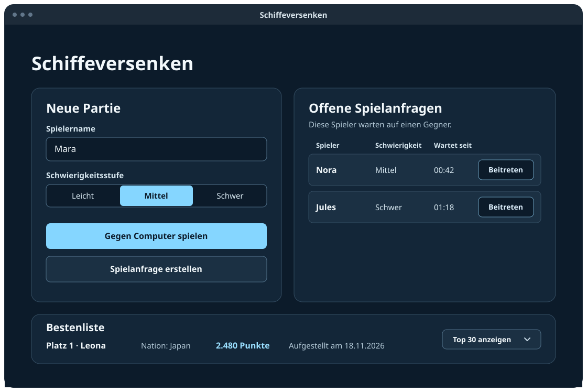
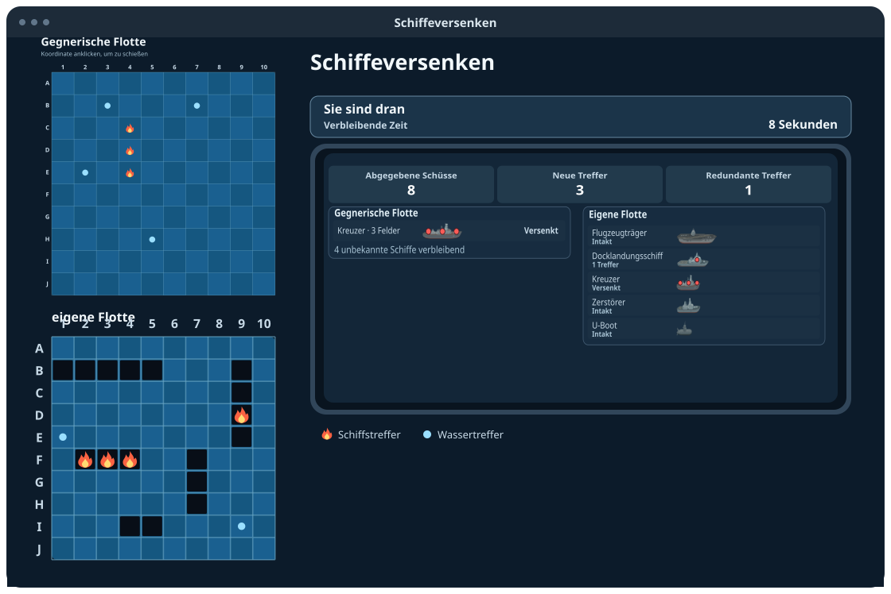
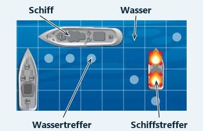

# Schiffeversenken – Anzeige im Browser

## Modus und Countdown

Der Browsertitel lautet **„Schiffeversenken“**.

Der Countdown steht bei der Platzierung links in der Flottenauswahl unter **„Schiffe platzieren“** und beginnt bei **01:00**. Während der Partie steht der Zugstatus im eigenen Rahmen über der Protokolltafel. Dort steht **„Sie sind dran“**, **„Der Computer ist dran“** oder bei einer Partie gegen einen Menschen dessen Spielername mit **„ist dran“**. Im eigenen Zug zeigt der Rahmen den Schuss-Countdown ab 12 Sekunden unter **„Verbleibende Zeit“** an. Schussergebnisse werden direkt auf den Rastern markiert. Der Computer wartet ab Zugbeginn oder nach seinem Treffer anderthalb Sekunden bis zum nächsten Schuss.

## Layout vor der Partie

### Startfenster

- **Links · Neue Partie** – Der Spieler trägt seinen Namen ein und wählt **Leicht**, **Mittel** oder **Schwer**. **Mittel** ist vorausgewählt. Die gewählte Stufe bestimmt die Anzeige der Wasserschüsse und die Zielwahl des Computers. Darunter stehen die Schaltflächen **„Gegen Computer spielen“** und **„Spielanfrage erstellen“**.
- **Rechts · Offene Spielanfragen** – Jede Zeile zeigt den Namen des wartenden Spielers, die gewählte Schwierigkeitsstufe, die Spalte **„Wartet seit“** und **„Beitreten“**. Die Wartezeit wird seit dem Erstellen der Anfrage im Format **MM:SS** hochgezählt. Beim Beitritt gilt die Stufe der Anfrage. Nach dem Erstellen einer eigenen Anfrage zeigt die Startseite **„Warten auf einen Gegner“**. Ist die Liste leer, erscheint **„Keine offenen Spielanfragen“**.

- **Unten · Bestenliste** – Platz 1 ist auf der Startseite immer mit Spielernamen, gespielter Nation, Punktzahl und dem Datum des Rekords sichtbar. Über **„Top 30 anzeigen“** lässt sich die Rangliste mit bis zu 30 Einträgen aufklappen. Jeder Eintrag zeigt Platz, Spielername, die für diese Partie gewählte Nation, Punktzahl und Datum. Platz 1 bleibt auch beim Zuklappen sichtbar.

Die Punkteberechnung ist noch offen. Der Ablauf der Spielanfragen steht im [Spielverlauf](Spielverlauf.md#partie-starten).

### Schiffe platzieren

- **Links · Flottenauswahl** – Der Spieler wählt die Nation und sieht die dazugehörigen [Schiffe](Schiffstypen.md) mit Typ, Länge und passender SVG-Vorschau. Darüber läuft der **60-Sekunden-Countdown**. Die Liste zeigt, welche Schiffe bereits platziert sind.
- **Rechts · Eigenes Spielfeld** – Das eigene **10 × 10-Raster** ist während der Platzierung genauso groß wie das gegnerische Zielraster in der späteren Partie.
- **Drag-and-drop** – Der Spieler zieht ein Schiff aus der Liste in das Raster. Beim Ziehen hebt die Vorschau die Felder hervor, die das Schiff belegen würde. Eine gültige Platzierung übernimmt das Schiff beim Ablegen. Im ersten Entwurf erscheinen belegte Felder auf dem Raster schwarz, während die Schiffsliste bereits die SVG-Vorschauen zeigt.

Nach Ablauf des Countdowns wechselt die Ansicht gemäß [Spielverlauf](Spielverlauf.md#flotte-und-platzierung) zur Partie oder zum Ergebnis.

## Layout während der Partie

Die Spielansicht besteht aus vier Elementen.

- **Links · Gegnerisches Zielraster** – Das große, interaktive Spielfeld. Der Spieler klickt auf einzelne Koordinatenfelder, um zu schießen. Die gegnerische Flotte bleibt verdeckt.
- **Rechts oben · Zugstatus** – Ein eigener Rahmen zeigt, wer am Zug ist. Auf schmalen Bildschirmen steht er über dem Zielraster.
- **Darunter · Protokolltafel** – Eine digitale Anzeige im Stil eines iPads mit den Schusszählern und dem Zustand der eigenen Flotte.
- **Rechts unten · eigene Flotte** – Unter der Protokolltafel liegt die kleinere Minikarte. Ihre Unterkante liegt auf derselben Höhe wie die des gegnerischen Zielrasters. Der Titel „eigene Flotte“ steht direkt über dem Raster, bündig mit dessen linker Kante. Während der Partie dient die Minikarte ausschließlich zur Anzeige.

## Spielfelder

Beide Spielfelder sehen aus wie Ausschnitte einer Seekarte und bestehen aus **10 × 10 quadratischen Feldern**. Innerhalb jedes Rasters sind alle Felder gleich groß. Links sind die Felder größer dargestellt, damit sich die einzelnen Koordinaten bequem anklicken lassen. Helle Gitterlinien unterteilen die blaue Wasserfläche. Die Zeilen A bis J stehen links, die Spalten 1 bis 10 oben.

## Schiffe

Im ersten Entwurf ist **jedes belegte Schiffsfeld schwarz**. Ein Schiff bildet eine zusammenhängende Reihe schwarzer Felder, waagerecht oder senkrecht. Die Gitterlinien bleiben sichtbar, sodass die belegten Koordinaten ablesbar sind.

Später ersetzen die [Schiffsbilder im SVG-Format](Schiffsbilder/Vektoren/) die schwarzen Felder. Jede Schiffsgrafik wird entsprechend der Platzierung ausgerichtet und erstreckt sich genau über die belegten Felder.

## Darstellung auf dem Spielfeld

- **Schiffstreffer** – Eine orange-gelbe Flamme mittig auf dem getroffenen Feld. Mehrere getroffene Felder desselben Schiffs erhalten je eine eigene Flamme. Bei einem erneuten Treffer auf dieselbe Koordinate bleibt es bei einer Flamme auf dem Feld.
- **Wasserschuss** – Ein einzelner runder, hellblauer Punkt mittig auf dem beschossenen Wasserfeld.

## Protokolltafel

Die Protokolltafel wirkt wie ein Tabletbildschirm mit einem schmalen Rahmen und einer klar gegliederten digitalen Anzeige. „Protokolltafel“ ist der interne Name. Sichtbare Überschriften sind **„Gegnerische Flotte“** und **„Eigene Flotte“**. Beide Bereiche haben innerhalb des Tablets jeweils einen eigenen Rahmen.

- **Eigene Schussergebnisse** – Zähler für abgegebene Schüsse, neue Treffer und alte Treffer. Sobald ein gegnerisches Schiff versenkt ist, erhält es wie ein eigenes Schiff eine Zeile mit seiner SVG-Grafik und roten Treffermarkierungen. Die Zeile nennt außerdem Typ, Länge und den Status „Versenkt“. Von den verbleibenden unbekannten gegnerischen Schiffen erscheint nur die Anzahl.
- **Zustand der eigenen Flotte** – Jedes eigene Schiff erhält eine Zeile mit seinem Typ und seinem Zustand, idealerweise mit der passenden SVG-Grafik. Die Zeilen haben eine feste Reihenfolge, und alle Grafiken sind gleich ausgerichtet, unabhängig von der Position und Ausrichtung der Schiffe auf dem Spielfeld. Eine rote Markierung zeigt jeden getroffenen Abschnitt direkt auf der Schiffsgrafik. Versenkte eigene Schiffe erhalten den Status „Versenkt“.

Die Flottenübersicht zeigt Treffer an eigenen Schiffen in allen [Schwierigkeitsstufen](Spielverlauf.md#schwierigkeitsstufen) ab dem ersten Treffer.

## Minikarte

Die Minikarte unter der Protokolltafel zeigt das eigene 10 × 10-Raster mit den tatsächlichen Schiffspositionen und -ausrichtungen. Gegnerische Schiffstreffer erscheinen sofort als Flammen. Auf „Leicht“ sind alle Wasserschüsse als hellblaue Punkte sichtbar. Auf „Mittel“ und „Schwer“ erscheinen Punkte nur unmittelbar waagerecht, senkrecht oder diagonal neben einem eigenen Schiffsfeld.

Bei einem sichtbaren Computerschuss pulsiert zusätzlich der Rahmen des beschossenen Feldes rund drei Sekunden lang. Bleibt ein Wasserschuss auf „Mittel“ oder „Schwer“ verborgen, pulsiert der Außenrahmen der Minikarte. Bei Wasser wechselt die Farbe zwischen Hell- und Dunkelblau, bei einem Schiffstreffer zwischen Hellgelb und Dunkelorange. Währenddessen läuft die Partie normal weiter.
